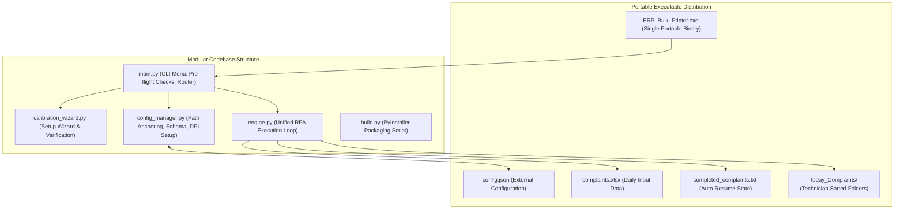

# Product Requirements Document (PRD)
## Project: Oracle ERP Bulk PDF Printer & Sorter (Phase 3)
**Document Version:** 1.2.0  
**Status:** Completed (All Phase 3 Steps Delivered)  
**Author:** Pair Programming Session (Antigravity & Lead Engineer)

---

### 1. Mandatory Workflow & Operating Rules
To maintain full system stability and traceability across development and deployment, all work must strictly adhere to the following rules:

1. **Git Integration & Traceability**:
   - Every completed step and code modification strictly requires an immediate Git commit with a clear, descriptive, standardized commit message following Conventional Commits format (`feat(...)`, `fix(...)`, `docs(...)`, etc.).
   - Every commit must be pushed to the remote repository (`origin/office-env`).
   - No untracked or undocumented changes are permitted.
2. **No Unprompted Refactoring**:
   - Working code from previous phases (e.g., `masterbot.py`, verified delay timings, and GUI interaction sequences) must NEVER be modified, rewritten, or refactored unless explicitly instructed by the user.
3. **Strict PRD & Step-by-Step Plan Alignment**:
   - Do not invent new logic or diverge from specifications. All implementations must map 100% directly to this PRD and the approved Phase 3 Execution Plan.
4. **Step-by-Step Approval Gate**:
   - Each phase step must be executed individually and presented for user review and approval before proceeding to the next step.

---

### 2. Executive Summary & Problem Statement
The existing RPA bot automates extraction of complaint job cards from an Oracle Forms ERP application, generates PDFs via Internet Explorer / Foxit Reader, and organizes them into technician-specific folders based on an Excel file.

However, all screen coordinates (`x, y`) were hardcoded in the codebase, causing automation failures when deployed across machines with different screen resolutions, aspect ratios, or Windows DPI scaling. Furthermore, office end-users lack Python environments, requiring a turnkey standalone executable (`.exe`).

**Phase 3 Objectives:**
1. **Decouple Configuration**: Externalize all screen coordinates, timing thresholds, file paths, and column mappings into `config.json`.
2. **Interactive Calibration Wizard (`setup.py`)**: Provide a guided CLI wizard with global hotkey capture, sound cues, and visual cursor verification.
3. **Dual-Input Mode**: Support both automated bulk processing from Excel and ad-hoc single-complaint manual extraction via a unified execution engine.
4. **Standalone Compilation**: Package the application into a single portable `.exe` using PyInstaller with correct runtime directory anchoring and DPI scaling awareness.

---

### 3. System Architecture & Component Design



#### 3.1 File & Module Responsibilities
- **`config_manager.py`** *(COMPLETED)*:
  - Detects runtime environment (`getattr(sys, 'frozen', False)`).
  - Resolves base directory to `os.path.dirname(sys.executable)` when frozen, and script directory when in development.
  - Enforces Per-Monitor DPI awareness via `ctypes.windll.shcore.SetProcessDpiAwareness(2)` (fallback to `SetProcessDPIAware`).
  - Reads, validates, and writes `config.json`.
  - Checks if the current screen resolution matches the calibrated resolution; warns if different.
- **`calibration_wizard.py`** *(COMPLETED - formerly `setup.py`)*:
  - Interactive CLI calibration wizard.
  - Listens globally for keypress (`Space` or `F8`) without requiring terminal focus.
  - Emits audio confirmation (`winsound.beep`), displays coordinates, and provides `[Y] Accept / [R] Retry` per step.
  - Runs **Tier 1 Verification (Visual Cursor Replay)**: glides the mouse across the 5 captured targets.
  - Runs **Tier 2 Verification (Optional Test Run)**: dispatches a single complaint test.
  - Provided `setup.py` alias for backwards compatibility.
- **`engine.py`**:
  - Unified RPA execution engine accepting an iterator of `(complaint_number, technician_name)`.
  - Implements the complete automation pipeline: focus ERP, double-click & input complaint, open print modal, toggle checkbox, dispatch print, trigger Foxit `Ctrl+P`, save PDF path, switch window with `Alt+Tab`, and exit modal.
  - Enforces dual kill-switch (`pyautogui.FAILSAFE = True` corner-slam + `keyboard.is_pressed('esc')`).
  - Records completed jobs in `completed_complaints.txt`.
- **`main.py`**:
  - Application entry point displaying the primary CLI interactive menu:
    - `[1] Bulk Mode (Process complaints.xlsx)`
    - `[2] Manual Mode (Process single complaint # entered in CLI)`
    - `[3] Recalibrate Coordinates (Setup Wizard)`
    - `[4] Exit`
  - Auto-launches Setup Wizard if `config.json` is missing.
  - Runs pre-flight checks (e.g. verifying `complaints.xlsx` is not locked in Excel).
- **`build.py`**:
  - Automated PyInstaller compilation script executing:
    `pyinstaller --onefile --console --name ERP_Bulk_Printer main.py`

---

### 4. Configuration Specification (`config.json`)

```json
{
  "screen_metadata": {
    "calibrated_resolution": [1366, 768],
    "calibration_timestamp": "2026-11-08 18:30:00"
  },
  "coordinates": {
    "complaint_input": {"x": 118, "y": 160},
    "main_print_btn": {"x": 1196, "y": 363},
    "ha_field_checkbox": {"x": 764, "y": 419},
    "popup_print_btn": {"x": 671, "y": 493},
    "popup_exit_btn": {"x": 749, "y": 493}
  },
  "timings": {
    "focus_delay": 0.5,
    "record_load_seconds": 3.0,
    "popup_wait_seconds": 2.0,
    "checkbox_wait_seconds": 1.0,
    "browser_pdf_load_seconds": 8.0,
    "foxit_print_dialog_seconds": 2.5,
    "save_dialog_seconds": 3.0,
    "file_save_processing_seconds": 4.0,
    "window_switch_seconds": 2.0,
    "popup_close_seconds": 1.0
  },
  "settings": {
    "excel_path": "complaints.xlsx",
    "complaint_column": "COMPLAINT_NO",
    "technician_column": "TECHNICIAN_NAME",
    "output_dir": "Today_Complaints",
    "progress_file": "completed_complaints.txt"
  }
}
```

---

### 5. Implementation Roadmap & Progress Tracker

| Step | Milestone | Status | Description |
| :--- | :--- | :---: | :--- |
| **3.1** | **`config_manager.py` & `config.json`** | **COMPLETED** | Path resolution (`sys.executable`), DPI awareness hook, JSON schema, and validation logic. |
| **3.2** | **`setup.py`** | **COMPLETED** | Interactive CLI calibration wizard with global hotkey (`Space`/`F8`), sound feedback, and visual cursor replay. |
| **3.3** | **`engine.py`** | **COMPLETED** | Extraction of the RPA execution loop from `masterbot.py` into a reusable function accepting `(complaint_id, tech_name)`. |
| **3.4** | **`main.py`** | **COMPLETED** | Interactive startup CLI menu, auto-calibration check, pre-flight file checks, and Dual-Input mode routing. |
| **3.5** | **`build.py` / `.spec`** | **COMPLETED** | Automated PyInstaller packaging script and frozen executable verification. |
| **3.6** | **Documentation & Testing** | **COMPLETED** | Verification test run and updated `README.md` with office user instructions. |

---

### 6. Audit & Traceability
Every phase step is committed and pushed with clear descriptions:
- **Step 3.1**: `feat(config): implement config_manager and externalized config.json (Step 3.1)`
- **Step 3.2**: `feat(setup): add interactive calibration wizard with hotkey capture and visual replay (Step 3.2)`
- **Step 3.3**: `feat(engine): extract unified RPA execution engine with safety aborts (Step 3.3)`
- **Step 3.4**: `feat(main): implement CLI menu router and dual-input execution (Step 3.4)`
- **Step 3.5**: `feat(build): add PyInstaller compilation script and spec configuration (Step 3.5)`
- **Step 3.6**: `docs: update user documentation for standalone executable and Phase 3 features (Step 3.6)`
