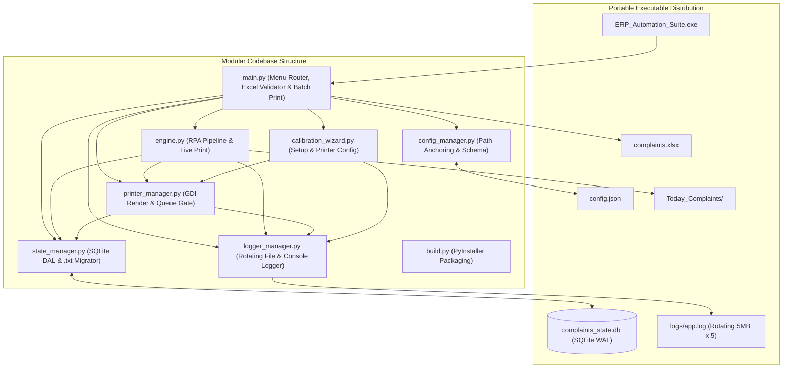

# Product Requirements Document (PRD)
## Project: Oracle ERP Bulk PDF Printer & Sorter (Phase 6: Enterprise Architecture, SQLite State & Observability)
**Document Version:** 2.0.0  
**Status:** Completed (Phase 6: SQLite WAL State Management, Rotating Logging & Strict Excel Validation)  
**Author:** Pair Programming Session (Antigravity & Lead Engineer)

---

### 1. Mandatory Workflow & Operating Rules
To maintain full system stability and traceability across development and deployment, all work must strictly adhere to the following rules:

1. **Git Integration & Traceability**:
   - Every completed step and code modification strictly requires an immediate Git commit with a clear, descriptive, standardized commit message following Conventional Commits format (`feat(...)`, `fix(...)`, `docs(...)`, etc.).
   - No untracked or undocumented changes are permitted.
2. **No Unprompted Refactoring**:
   - Working code from previous phases (e.g., `legacy/masterbot.py`, verified delay timings, and GUI interaction sequences) must NEVER be modified, rewritten, or refactored unless explicitly instructed by the user.
3. **Strict PRD & Step-by-Step Plan Alignment**:
   - Do not invent new logic or diverge from specifications. All implementations must map 100% directly to this PRD and the approved Execution Plan.

---

### 2. Executive Summary & Problem Statement
The RPA bot automates extraction of complaint job cards from an Oracle Forms ERP application, generates PDFs via Internet Explorer / Foxit Reader, organizes them into technician-specific folders based on an Excel file, performs silent physical printing via Windows GDI (`pypdfium2` + `win32ui`), and automates OTP generation.

In **Phase 6**, we upgrade the underlying architecture to enterprise-grade standards:
1. **SQLite State Management (`state_manager.py` / `complaints_state.db`)**:
   - Replaces legacy flat text files (`completed_complaints.txt`, `printed_complaints.txt`) with an ACID-compliant local SQLite database operating in Write-Ahead Logging (`WAL`) mode (`PRAGMA journal_mode=WAL; PRAGMA synchronous=NORMAL;`).
   - Tracks unified progressive lifecycle states (`DOWNLOADED`, `SPOOLED`, `PRINTED`, `PRINT_FAILED`) alongside `technician`, `file_path`, `printer_name`, `job_id`, `created_at`, and `updated_at`.
   - Automatically migrates existing legacy `.txt` files on first run and renames them to `.migrated.bak`.
   - Supports non-destructive print tracker resets (`[R] Reset Global Print Tracker` in Mode `[5]`), archiving a consistent SQLite backup (`complaints_state_<timestamp>.db.bak`) via `sqlite3.Connection.backup()` and downgrading `SPOOLED`/`PRINTED`/`PRINT_FAILED` rows back to `DOWNLOADED` so ERP downloads are never lost.
2. **Enterprise-Grade Centralized Logging (`logger_manager.py`)**:
   - Dual-channel logging architecture:
     - **File Handler**: `RotatingFileHandler` writing to `logs/app.log` (5 MB max size, 5 backups, UTF-8, `DEBUG` level) with full timestamps, `module:function:line`, and full stack traces (`exc_info=True`).
     - **Console Handler**: `StreamHandler` (`INFO` level) with clean, operator-friendly formatting while preserving crisp interactive CLI menus and tables.
     - **Crash Hook**: Global `sys.excepthook` guarantees any unhandled fatal exception is captured in `logs/app.log`.
3. **Strict Excel Input Validation & Sanitization (`main.py`)**:
   - Normalizes column headers (whitespace stripping + case-insensitive fallback matching).
   - Enforces strict numeric-digit validation for `COMPLAINT_NO` (after stripping whitespace and `.0` float suffixes), safely skipping and logging empty rows, formula error strings (`#REF!`, `#N/A`, `#VALUE!`), and malformed entries with exact 1-based Excel row numbers.
   - Deduplicates repeated `COMPLAINT_NO` values within the sheet (preserving first occurrence) and sanitizes `TECHNICIAN_NAME` (defaulting blanks to `'Unknown'`).
   - Displays a **Pre-Flight Validation Summary** before batch execution begins.

---

### 3. System Architecture & Component Design



#### 3.1 File & Module Responsibilities
- **`state_manager.py`** *(NEW - COMPLETED)*:
  - Manages `complaints_state.db` in SQLite WAL mode with `busy_timeout=15000`.
  - Auto-migrates legacy `completed_complaints.txt` and `printed_complaints.txt` into SQLite and renames them to `.migrated.bak`.
  - Provides transactional state mutations (`mark_complaint_downloaded`, `mark_complaint_spooled`, `mark_complaint_printed`, `mark_complaint_print_failed`, `reset_printed_tracker_safe`) and queries (`get_completed_complaints`, `load_printed_complaints`).
- **`logger_manager.py`** *(NEW - COMPLETED)*:
  - Configures centralized `erp_automation` logger hierarchy with `RotatingFileHandler` (`logs/app.log`, 5 MB, 5 backups, UTF-8, `DEBUG`+) and console `StreamHandler` (`INFO`+), plus `sys.excepthook`.
- **`printer_manager.py`** *(UPDATED - COMPLETED)*:
  - Headless GDI PDF rendering via `pypdfium2` + `win32ui`, spooler queue monitoring, sliding-window reconciliation, and SQLite state persistence via `state_manager`.
- **`config_manager.py`** *(UPDATED - COMPLETED)*:
  - Path anchoring (`sys.executable` when frozen), Per-Monitor DPI awareness, and schema defaults/validation for `coordinates`, `timings`, `settings` (`database_file`), `printing`, and `logging`.
- **`calibration_wizard.py`** *(UPDATED - COMPLETED)*:
  - Coordinate calibration for Print (5), OTP (4), or All (9) targets, and physical printer configuration with structured logging.
- **`engine.py`** *(UPDATED - COMPLETED)*:
  - Unified RPA loop for complaint extraction and PDF creation with global ESC key latching, `Ctrl+C` handling, SQLite progress tracking, and Live Print dispatch.
- **`main.py`** *(UPDATED - COMPLETED)*:
  - Primary menu (`[1]`–`[7]`), strict Excel validation & Pre-Flight Validation Summary (`validate_excel_dataframe`, `validate_and_load_excel_records`), and SQLite-backed Offline Batch Print (`[5]`).
- **`build.py`** *(UPDATED - COMPLETED)*:
  - Compiles `--onedir` distribution `dist/ERP_Automation_Suite/` preserving `complaints_state.db`, `logs/`, `Today_Complaints/`, `config.json`, and `complaints.xlsx`.

---

### 4. Configuration Specification (`config.json`)

```json
{
  "screen_metadata": {
    "calibrated_resolution": [1366, 768],
    "calibration_timestamp": "2026-11-08 18:30:00"
  },
  "coordinates": {
    "complaint_input": {"x": 118, "y": 160},
    "main_print_btn": {"x": 1196, "y": 363},
    "ha_field_checkbox": {"x": 764, "y": 419},
    "popup_print_btn": {"x": 671, "y": 493},
    "popup_exit_btn": {"x": 749, "y": 493},
    "otp_add_btn": {"x": 200, "y": 200},
    "otp_complaint_search_btn": {"x": 350, "y": 250},
    "otp_search_input": {"x": 500, "y": 300},
    "otp_reason_search_btn": {"x": 350, "y": 350}
  },
  "timings": {
    "focus_delay": 0.5,
    "record_load_seconds": 3.0,
    "popup_wait_seconds": 2.0,
    "checkbox_wait_seconds": 1.0,
    "browser_pdf_load_seconds": 8.0,
    "foxit_print_dialog_seconds": 2.5,
    "save_dialog_seconds": 3.0,
    "file_save_processing_seconds": 4.0,
    "window_switch_seconds": 2.0,
    "popup_close_seconds": 1.0,
    "otp_window_open_seconds": 1.5,
    "otp_search_modal_seconds": 1.2,
    "otp_reason_focus_seconds": 1.0,
    "otp_enter_delay_seconds": 0.3
  },
  "settings": {
    "excel_path": "complaints.xlsx",
    "complaint_column": "COMPLAINT_NO",
    "technician_column": "TECHNICIAN_NAME",
    "output_dir": "Today_Complaints",
    "progress_file": "completed_complaints.txt",
    "database_file": "complaints_state.db"
  },
  "printing": {
    "printer_name": null,
    "max_spool_queue": 3,
    "enable_live_print": false,
    "printed_tracker_file": "printed_complaints.txt"
  },
  "logging": {
    "log_dir": "logs",
    "log_file": "app.log",
    "max_bytes": 5242880,
    "backup_count": 5,
    "file_level": "DEBUG",
    "console_level": "INFO"
  }
}
```

---

### 5. Implementation Roadmap & Progress Tracker

| Step | Milestone | Status | Description |
| :--- | :--- | :---: | :--- |
| **Phase 3** | **Architecture & Hardening** | **COMPLETED** | Decoupled config, calibration wizard, dual-input, PyInstaller packaging. |
| **Phase 4** | **OTP & One-Dir Packaging** | **COMPLETED** | OTP module, one-dir packaging, routing & batch enhancements. |
| **Phase 5** | **Silent Physical Printing** | **COMPLETED** | Headless GDI rendering, spooler monitoring, sliding-window batch print. |
| **6.1** | **Centralized Logging (`logger_manager.py`)** | **COMPLETED** | Dual-channel `RotatingFileHandler` (`logs/app.log`, 5 MB x 5) + console logger & crash hook. |
| **6.2** | **SQLite State Engine (`state_manager.py`)** | **COMPLETED** | SQLite WAL database (`complaints_state.db`), progressive status schema & legacy `.txt` auto-migration. |
| **6.3** | **Core Engine & Spooler Integration** | **COMPLETED** | Integrate `state_manager` and `logger_manager` across `engine.py`, `printer_manager.py`, and `calibration_wizard.py`. |
| **6.4** | **Strict Excel Input Validation** | **COMPLETED** | Implement header normalization, numeric ID validation, deduplication, and Pre-Flight Validation Summary in `main.py`. |
| **6.5** | **Packaging & Documentation** | **COMPLETED** | Update `build.py` runtime preservation for SQLite/logs and synchronize `PRD.md` & `README.md`. |
