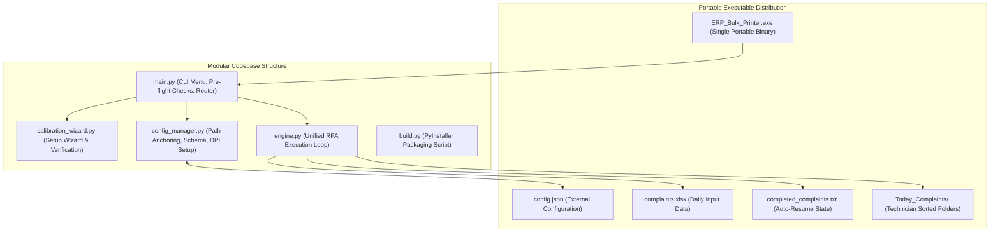

# Product Requirements Document (PRD)
## Project: Oracle ERP Bulk PDF Printer & Sorter (Phase 4: OTP Generation & One-Dir Deployment)
**Document Version:** 1.3.0  
**Status:** In Progress (Phase 4 Underway)  
**Author:** Pair Programming Session (Antigravity & Lead Engineer)

---

### 1. Mandatory Workflow & Operating Rules
To maintain full system stability and traceability across development and deployment, all work must strictly adhere to the following rules:

1. **Git Integration & Traceability**:
   - Every completed step and code modification strictly requires an immediate Git commit with a clear, descriptive, standardized commit message following Conventional Commits format (`feat(...)`, `fix(...)`, `docs(...)`, etc.).
   - Every commit must be pushed to the remote feature repository (`origin/feature/otp-generation`). Do not merge into `main` directly.
   - No untracked or undocumented changes are permitted.
2. **No Unprompted Refactoring**:
   - Working code from previous phases (e.g., `masterbot.py`, verified delay timings, and GUI interaction sequences) must NEVER be modified, rewritten, or refactored unless explicitly instructed by the user.
3. **Strict PRD & Step-by-Step Plan Alignment**:
   - Do not invent new logic or diverge from specifications. All implementations must map 100% directly to this PRD and the approved Phase 4 Execution Plan.
4. **Step-by-Step Approval Gate**:
   - Each phase step must be executed individually and presented for user review and approval before proceeding to the next step.

---

### 2. Executive Summary & Problem Statement
The RPA bot automates extraction of complaint job cards from an Oracle Forms ERP application, generates PDFs via Internet Explorer / Foxit Reader, and organizes them into technician-specific folders based on an Excel file.

In Phase 4, we expand the automation suite to include **Automated OTP Generation** and resolve the Windows `%TEMP%` permission failure ("Run as Administrator" bug) by migrating to a **One-Dir (`--onedir`) Distribution Architecture** (`ERP_Automation_Suite/`).

**Phase 4 Objectives:**
1. **Schema & Configuration Modernization**: Expand `config.json` and `config_manager.py` to support 4 new OTP UI coordinates (`otp_add_btn`, `otp_complaint_search_btn`, `otp_search_input`, `otp_reason_search_btn`) and dedicated OTP timing thresholds.
2. **Modular Calibration Wizard**: Introduce a sub-menu allowing operators to calibrate Bulk Print targets (5), OTP targets (4), or All targets (9) independently.
3. **OTP Engine Implementation**: Implement isolated `generate_otp()` routine in `engine.py` using double-click text clearance, `pyperclip` clipboard pasting, coordinate focus double-tap, and 4x Enter confirmation.
4. **Interactive Continuous Loop**: Add option `[4] Generate OTP` in `main.py` enabling back-to-back OTP generations with safety countdowns.
5. **One-Dir Packaging Architecture**: Refactor `build.py` to package `dist/ERP_Automation_Suite/` containing `ERP_Automation_Suite.exe`, avoiding `%TEMP%` extraction errors permanently.

---

### 3. System Architecture & Component Design



#### 3.1 File & Module Responsibilities
- **`config_manager.py`** *(COMPLETED)*:
  - Detects runtime environment (`getattr(sys, 'frozen', False)`).
  - Resolves base directory to `os.path.dirname(sys.executable)` when frozen, and script directory when in development.
  - Enforces Per-Monitor DPI awareness via `ctypes.windll.shcore.SetProcessDpiAwareness(2)` (fallback to `SetProcessDPIAware`).
  - Reads, validates, and writes `config.json`.
  - Checks if the current screen resolution matches the calibrated resolution; warns if different.
- **`calibration_wizard.py`** *(COMPLETED - formerly `setup.py`)*:
  - Interactive CLI calibration wizard.
  - Listens globally for keypress (`Space` or `F8`) without requiring terminal focus.
  - Emits audio confirmation (`winsound.beep`), displays coordinates, and provides `[Y] Accept / [R] Retry` per step.
  - Runs **Tier 1 Verification (Visual Cursor Replay)**: glides the mouse across the 5 captured targets.
  - Runs **Tier 2 Verification (Optional Test Run)**: dispatches a single complaint test.
  - Provided `setup.py` alias for backwards compatibility.
- **`engine.py`**:
  - Unified RPA execution engine accepting an iterator of `(complaint_number, technician_name)`.
  - Implements the complete automation pipeline: focus ERP, double-click & input complaint, open print modal, toggle checkbox, dispatch print, trigger Foxit `Ctrl+P`, save PDF path, switch window with `Alt+Tab`, and exit modal.
  - Enforces dual kill-switch (`pyautogui.FAILSAFE = True` corner-slam + `keyboard.is_pressed('esc')`).
  - Records completed jobs in `completed_complaints.txt`.
- **`main.py`**:
  - Application entry point displaying the primary CLI interactive menu:
    - `[1] Bulk Mode (Process complaints.xlsx)`
    - `[2] Manual Mode (Process single complaint # entered in CLI)`
    - `[3] Recalibrate Coordinates (Setup Wizard)`
    - `[4] Exit`
  - Auto-launches Setup Wizard if `config.json` is missing.
  - Runs pre-flight checks (e.g. verifying `complaints.xlsx` is not locked in Excel).
- **`build.py`**:
  - Automated PyInstaller compilation script executing:
    `pyinstaller --onefile --console --name ERP_Bulk_Printer main.py`

---

### 4. Configuration Specification (`config.json`)

```json
{
  "screen_metadata": {
    "calibrated_resolution": [1366, 768],
    "calibration_timestamp": "2026-11-08 18:30:00"
  },
  "coordinates": {
    "complaint_input": {"x": 118, "y": 160},
    "main_print_btn": {"x": 1196, "y": 363},
    "ha_field_checkbox": {"x": 764, "y": 419},
    "popup_print_btn": {"x": 671, "y": 493},
    "popup_exit_btn": {"x": 749, "y": 493},
    "otp_add_btn": {"x": 200, "y": 200},
    "otp_complaint_search_btn": {"x": 350, "y": 250},
    "otp_search_input": {"x": 500, "y": 300},
    "otp_reason_search_btn": {"x": 350, "y": 350}
  },
  "timings": {
    "focus_delay": 0.5,
    "record_load_seconds": 3.0,
    "popup_wait_seconds": 2.0,
    "checkbox_wait_seconds": 1.0,
    "browser_pdf_load_seconds": 8.0,
    "foxit_print_dialog_seconds": 2.5,
    "save_dialog_seconds": 3.0,
    "file_save_processing_seconds": 4.0,
    "window_switch_seconds": 2.0,
    "popup_close_seconds": 1.0,
    "otp_window_open_seconds": 1.5,
    "otp_search_modal_seconds": 1.2,
    "otp_reason_focus_seconds": 1.0,
    "otp_enter_delay_seconds": 0.3
  },
  "settings": {
    "excel_path": "complaints.xlsx",
    "complaint_column": "COMPLAINT_NO",
    "technician_column": "TECHNICIAN_NAME",
    "output_dir": "Today_Complaints",
    "progress_file": "completed_complaints.txt"
  }
}
```

---

### 5. Implementation Roadmap & Progress Tracker

| Step | Milestone | Status | Description |
| :--- | :--- | :---: | :--- |
| **Phase 3** | **Architecture & Hardening** | **COMPLETED** | Decoupled config, calibration wizard, dual-input, PyInstaller packaging. |
| **4.1** | **Branch & Workspace Baseline** | **COMPLETED** | Create `feature/otp-generation` and clean runtime files. |
| **4.2** | **Config & Schema Modernization** | **COMPLETED** | Expand schema with 4 OTP targets and timings; update validation logic. |
| **4.3** | **Modular Calibration Wizard** | **COMPLETED** | Calibration sub-menu for Print (5), OTP (4), or All (9) targets. |
| **4.4** | **OTP Generation Engine Logic** | **PENDING** | Isolated `generate_otp()` with clipboard pasting and double-tap focus. |
| **4.5** | **CLI Menu Expansion & Loop** | **PENDING** | Main menu option `[4] Generate OTP` with continuous interactive loop. |
| **4.6** | **One-Dir Architecture Packaging** | **PENDING** | Refactor `build.py` to compile `--onedir` distribution `ERP_Automation_Suite`. |
| **4.7** | **Verification & Documentation** | **PENDING** | Standalone verification and updated office instructions. |

---

### 6. Audit & Traceability
Every phase step is committed and pushed with clear descriptions:
- **Phase 3 Baseline**: Committed and tested on `office-env`.
- **Step 4.1**: `chore: initialize feature/otp-generation branch`
- **Step 4.2**: `feat(config): add 4 OTP targets and timing thresholds to configuration schema (Step 4.2)`
- **Step 4.3**: `feat(wizard): implement modular sub-menu for print and OTP coordinate calibration (Step 4.3)`
