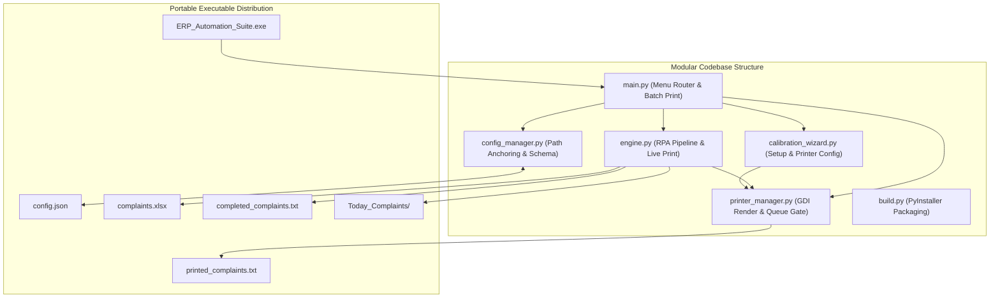

# Product Requirements Document (PRD)
## Project: Oracle ERP Bulk PDF Printer & Sorter (Phase 5: Universal Silent Printing & Spooler Integration)
**Document Version:** 1.7.0  
**Status:** Completed (Phase 5: Universal Silent Physical Printing & Spooler Queue Monitoring)  
**Author:** Pair Programming Session (Antigravity & Lead Engineer)

---

### 1. Mandatory Workflow & Operating Rules
To maintain full system stability and traceability across development and deployment, all work must strictly adhere to the following rules:

1. **Git Integration & Traceability**:
   - Every completed step and code modification strictly requires an immediate Git commit with a clear, descriptive, standardized commit message following Conventional Commits format (`feat(...)`, `fix(...)`, `docs(...)`, etc.).
   - Every commit must be pushed to the remote feature repository (`origin/feature/silent-printing`). Do not merge into `main` directly.
   - No untracked or undocumented changes are permitted.
2. **No Unprompted Refactoring**:
   - Working code from previous phases (e.g., `masterbot.py`, verified delay timings, and GUI interaction sequences) must NEVER be modified, rewritten, or refactored unless explicitly instructed by the user.
3. **Strict PRD & Step-by-Step Plan Alignment**:
   - Do not invent new logic or diverge from specifications. All implementations must map 100% directly to this PRD and the approved Execution Plan.
4. **Step-by-Step Approval Gate**:
   - Each phase step must be executed individually and presented for user review and approval before proceeding to the next step.

---

### 2. Executive Summary & Problem Statement
The RPA bot automates extraction of complaint job cards from an Oracle Forms ERP application, generates PDFs via Internet Explorer / Foxit Reader, organizes them into technician-specific folders based on an Excel file, and automates OTP generation.

In Phase 5, we integrate **Universal Silent Physical Printing**:
- Eliminates reliance on external PDF viewers (Foxit, Acrobat, Edge) for physical printing, preventing GUI pop-ups or taskbar window focus theft that could disrupt Oracle Forms automation.
- Directly renders PDF pages into Windows GDI Printer Device Contexts using `pypdfium2` and `win32ui`/`win32print`.
- Monitors the Windows Print Spooler queue. If jobs accumulate (default threshold: 3) or hardware/spooler errors occur (paper jam, tray empty, offline, paused printer/job, or spooler query errors), the bot alerts the operator and pauses execution.
- Introduces **Dual Print Modes**: Live Print (print on download with resume retry for unprinted saved PDFs) and Offline Batch Print (process existing PDFs in `Today_Complaints/` with resume awareness).

**Phase 5 Objectives:**
1. **Universal Headless GDI Rendering**: Use `pypdfium2` and `win32ui`/`win32print` to render PDF pages directly into the Windows GDI DC. 100% silent, zero pop-ups, works across all PCL, PostScript, and GDI printer drivers.
2. **Spooler Queue Monitoring & Failsafe**: Query active jobs (`cJobs`) and status flags (`PRINTER_STATUS_PAUSED`, `PRINTER_STATUS_PAPER_JAM`, `PRINTER_STATUS_PAPER_OUT`, `JOB_STATUS_PAUSED`, `JOB_STATUS_ERROR`, etc.), and surface `GetPrinter`/`EnumJobs` failures as alerts. Pause with audio alerts if queue reaches threshold or error flags are present, and restore ERP window focus after interactive queue gate choices.
3. **Printer Setup in Calibration Wizard & Main Menu**: Sub-menu option `[4] Configure Physical Printer & Spooler` in Calibration Wizard and Main Menu option `[6] Select / Change Target Printer` to enumerate connected printers (`1..N`), validate physical vs. virtual classification, set queue limit, and check spooler error flags.
4. **Configuration Schema Expansion**: Add `"printing"` section to `config.json` and `config_manager.py` with automatic physical/default printer fallback.
5. **Resume Tracking & Job Reconciliation (`printed_complaints.txt`)**: Track PDF completion (`completed_complaints.txt`) separately from print completion (`printed_complaints.txt`). Record jobs as `SPOOLED` upon `EndDoc` and reconcile against the spooler before recording `PRINTED`, keeping failed, deleted, or unresolved jobs eligible for retry.
6. **Dual Print Integration**:
   - **Live Print**: Immediately spools and reconciles PDF upon download in Bulk Mode `[1]` and Manual Mode `[2]`, and retries unprinted saved PDFs upon resume.
   - **Offline Batch Print**: Main Menu option `[5]` to scan `Today_Complaints/` and silent-print unprinted documents.
7. **One-Dir Packaging**: Update `build.py` to bundle `pypdfium2` DLLs and `pywin32` runtime modules into `dist/ERP_Automation_Suite/`.

---

### 3. System Architecture & Component Design



#### 3.1 File & Module Responsibilities
- **`printer_manager.py`** *(NEW - COMPLETED)*:
  - Enumerates connected Windows printers via `win32print.EnumPrinters()` with graceful error handling.
  - Queries active spooler job count (`cJobs`) and printer/job error and pause status flags (`PRINTER_STATUS_PAUSED`, `JOB_STATUS_PAUSED`, etc.), treating `GetPrinter` and `EnumJobs` failures as alerts.
  - Implements `enforce_queue_gate()` to pause with audio alerts when queue is backed up or in error/paused state.
  - Implements `print_pdf_silent()`: headless page-by-page rasterization via `pypdfium2` streamed to GDI Printer DC (`win32ui`).
  - Implements `mark_complaint_spooled()`, `reconcile_print_job()`, `mark_complaint_printed()`, `load_printed_complaints()`, and `reset_printed_tracker_safe()` with strict error propagation and safe backup verification.
- **`config_manager.py`** *(UPDATED - COMPLETED)*:
  - Path anchoring (`sys.executable` when frozen), Per-Monitor DPI awareness.
  - Validates and provides fallback resolution for `"printing"` section (`printer_name`, `max_spool_queue`, `enable_live_print`, `printed_tracker_file`).
- **`calibration_wizard.py`** *(UPDATED - COMPLETED)*:
  - Coordinate calibration for Print (5), OTP (4), or All (9) targets.
  - Sub-menu option `[4] Configure Physical Printer & Spooler` for printer selection, queue limits, and spooler error flag check.
- **`engine.py`** *(UPDATED - COMPLETED)*:
  - Unified RPA loop for complaint extraction and PDF creation with global ESC key latching and `Ctrl+C` handling.
  - Live Print dispatch: verifies queue gate, restores ERP foreground focus after interactive gate prompts, spools and reconciles print jobs, and retries saved PDFs missing from `printed_complaints.txt` on batch resume.
  - OTP generation routine (`generate_otp()`).
- **`main.py`** *(UPDATED - COMPLETED)*:
  - Primary menu:
    - `[1] Bulk Mode (Process complaints.xlsx)` (with routing & live print prompts)
    - `[2] Manual Mode (Process single/batch complaint #s)` (with live print prompt)
    - `[3] Recalibrate Coordinates (Setup Wizard)`
    - `[4] Generate OTP (Interactive Mode)`
    - `[5] Batch Print Offline PDFs (Today_Complaints)`
    - `[6] Select / Change Target Printer`
    - `[7] Exit`
  - Manages runtime file and parent directory creation (`completed_complaints.txt`, `printed_complaints.txt`).
- **`build.py`** *(UPDATED - COMPLETED)*:
  - Compiles `--onedir` distribution `dist/ERP_Automation_Suite/` with `pypdfium2` binaries and `pywin32` hidden imports.

---

### 4. Configuration Specification (`config.json`)

```json
{
  "screen_metadata": {
    "calibrated_resolution": [1366, 768],
    "calibration_timestamp": "2026-11-08 18:30:00"
  },
  "coordinates": {
    "complaint_input": {"x": 118, "y": 160},
    "main_print_btn": {"x": 1196, "y": 363},
    "ha_field_checkbox": {"x": 764, "y": 419},
    "popup_print_btn": {"x": 671, "y": 493},
    "popup_exit_btn": {"x": 749, "y": 493},
    "otp_add_btn": {"x": 200, "y": 200},
    "otp_complaint_search_btn": {"x": 350, "y": 250},
    "otp_search_input": {"x": 500, "y": 300},
    "otp_reason_search_btn": {"x": 350, "y": 350}
  },
  "timings": {
    "focus_delay": 0.5,
    "record_load_seconds": 3.0,
    "popup_wait_seconds": 2.0,
    "checkbox_wait_seconds": 1.0,
    "browser_pdf_load_seconds": 8.0,
    "foxit_print_dialog_seconds": 2.5,
    "save_dialog_seconds": 3.0,
    "file_save_processing_seconds": 4.0,
    "window_switch_seconds": 2.0,
    "popup_close_seconds": 1.0,
    "otp_window_open_seconds": 1.5,
    "otp_search_modal_seconds": 1.2,
    "otp_reason_focus_seconds": 1.0,
    "otp_enter_delay_seconds": 0.3
  },
  "settings": {
    "excel_path": "complaints.xlsx",
    "complaint_column": "COMPLAINT_NO",
    "technician_column": "TECHNICIAN_NAME",
    "output_dir": "Today_Complaints",
    "progress_file": "completed_complaints.txt"
  },
  "printing": {
    "printer_name": null,
    "max_spool_queue": 3,
    "enable_live_print": false,
    "printed_tracker_file": "printed_complaints.txt"
  }
}
```

---

### 5. Implementation Roadmap & Progress Tracker

| Step | Milestone | Status | Description |
| :--- | :--- | :---: | :--- |
| **Phase 3** | **Architecture & Hardening** | **COMPLETED** | Decoupled config, calibration wizard, dual-input, PyInstaller packaging. |
| **Phase 4** | **OTP & One-Dir Packaging** | **COMPLETED** | OTP module, one-dir packaging, routing & batch enhancements. |
| **5.1** | **Dependencies & Feature Branch** | **COMPLETED** | Create `feature/silent-printing`, add `pywin32` & `pypdfium2` to `requirements.txt`. |
| **5.2** | **Print & Queue Manager** | **COMPLETED** | Create `printer_manager.py` with headless GDI rendering and spooler monitoring. |
| **5.3** | **Schema & Config Modernization** | **COMPLETED** | Expand `config.json` & `config_manager.py` with `"printing"` section & validation. |
| **5.4** | **Calibration Wizard Expansion** | **COMPLETED** | Add option `[4]` to `calibration_wizard.py` for printer selection & queue limit. |
| **5.5** | **Resume Tracker & Reconciliation** | **COMPLETED** | Implement `printed_complaints.txt` management, `SPOOLED` vs `PRINTED` reconciliation, and error propagation. |
| **5.6** | **Dual Print Modes Integration** | **COMPLETED** | Live Print in `engine.py` (with focus restoration & resume retry) and Offline Batch Print `[5]` in `main.py`. |
| **5.7** | **Packaging & Verification** | **COMPLETED** | Bundle `pypdfium2` and `pywin32` into `dist/ERP_Automation_Suite/`. |
| **5.8** | **Documentation & Audit** | **COMPLETED** | Synchronize `PRD.md` and `README.md` with Phase 5 specs. |

---

### 6. Audit & Traceability
Every phase step is committed and pushed with clear descriptions:
- **Step 5.1**: `chore(deps): initialize feature/silent-printing and add pywin32, pypdfium2 dependencies`
- **Step 5.2**: `feat(print): create printer_manager with headless GDI rendering and spooler queue monitoring`
- **Step 5.3**: `feat(config): expand config schema with printing preferences and validation rules`
- **Step 5.4**: `feat(wizard): add printer selection and test-print verification to calibration wizard`
- **Step 5.5 & 5.6**: `feat(engine): integrate live printing, resume tracker, and offline batch print mode [5]`
- **Step 5.7**: `chore(build): configure PyInstaller bundling for pypdfium2 and pywin32 in onedir distribution`
- **Step 5.8**: `docs: update PRD and README with Phase 5 silent printing specifications`
